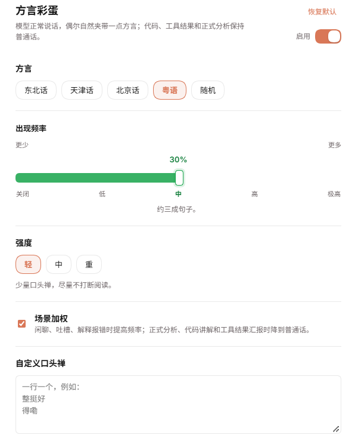
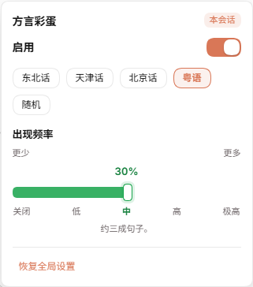
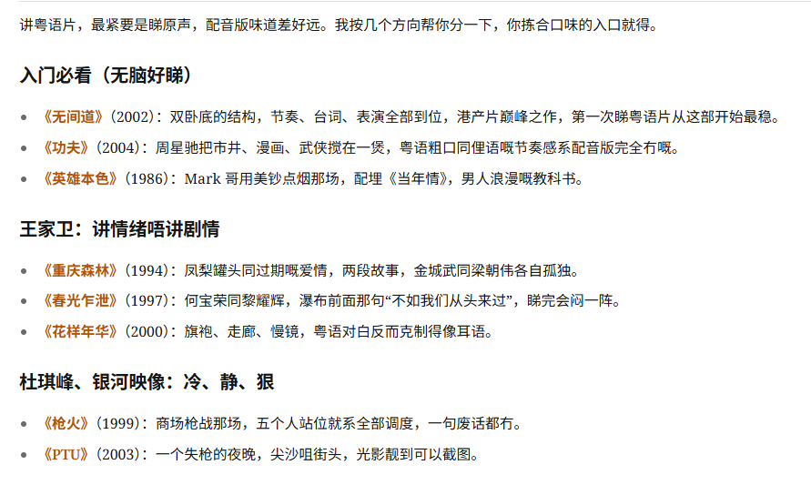

# dsh-dialect · Dialect spice

English | [中文](README.md)

Keep answers in plain Mandarin and occasionally season them with a little dialect flavor — Northeast, Tianjin, Beijing, or Cantonese. Full configuration lives in Settings; a compact control beside the composer adjusts the current session. High and max levels carry warning colors and never turn a whole answer into dialect.

<p align="left">
  <a href="https://www.npmjs.com/package/dsh-dialect"></a>
  
  
  
  
</p>

## Screenshots

| Settings page | Composer control |
| --- | --- |
|  |  |

### Cantonese answer



The answer content is illustrative only.

## Features

| Setting | Description |
| --- | --- |
| Entry points | Settings → Dialect spice for global defaults; the composer button for the current session |
| Dialect | Northeast, Tianjin, Beijing, Cantonese, or random |
| Random pool | In random mode, draw one dialect per session from the selected pool and keep it stable |
| Frequency | Off / 20% / 30% / 40% / 50%; low gray, medium green, high orange, max red |
| Intensity | Light, medium, heavy |
| Scene weighting | Raise the frequency for casual chat and error explanations; lower it for formal analysis and tool results |
| Custom phrases | One per line, up to 12 entries of 24 characters each |
| Auto-save | Writes to `~/.dsh/dsh-dialect.json`; no save button |

## Install

```sh
# Web (recommended)
dsh plugin --profile web add dsh-dialect

# DSH Desktop
dsh plugin --profile desktop add dsh-dialect

# Or from GitHub
dsh plugin --profile web add github:Luoqiaocong/dsh-dialect
```

You can also open **Plugins → Add plugin**, enter `dsh-dialect`, install, and choose **Enable now**. Refresh the page; if Settings has no "Dialect spice" entry, restart `dsh web` once.

## Usage

1. Open **Settings → Dialect spice** and choose a dialect, random pool, frequency, and intensity.
2. To change only the current session, click the "语 东北话" button beside the composer.
3. Choose **Restore global settings** in the popover, or **Restore defaults** beside the switch at the top of the Settings page.

## Frequency levels

| Level | Approx. share | Note |
| --- | --- | --- |
| Off | 0% | no dialect |
| Low | 20% | about one sentence in five; default |
| Medium | 30% | about three sentences in ten |
| High | 40% | best for casual chat |
| Max | 50% | best for casual chat |

Even at max the answer is not entirely dialect; code blocks, tool output, and file contents always stay plain.

## Compatibility

| Item | Details |
| --- | --- |
| DSH | `0.2.2-rc.1` or newer, declared in `dsh.engines.dsh` and checked at install |
| Node | `24.9.0` or newer |
| Platform | Web (Chrome / Edge / Firefox / Safari) and DSH Desktop |
| Dependencies | No runtime dependencies; talks only to the local Host, no external network or telemetry |
| Storage | Global settings in `~/.dsh/dsh-dialect.json`; session overrides stay in memory |

## How it works

- The Host registers one system-prompt section at `order: 100`, between the persona prefix and the tool instructions.
- Global settings live in a local JSON file read and written by Host routes; `localStorage` is only a first-paint cache.
- The composer override is keyed by session id and kept in Host memory, never written to the global file.
- Random mode caches its draw per session, so the dialect does not change between messages.

## Limits

- This is a prompt-level soft constraint; frequency is descriptive, not an exact count.
- It never rewrites code blocks, tool output, file contents, or existing transcript rows.
- Subagents read the global settings too; disable the plugin for them if they must stay plain.
- A local-directory install is a `link:` — do not move the folder. npm installs have no such limit.

## Development

No build step. Edit `lib/client.js` or `lib/index.js` and refresh; `npm run check` runs syntax checks and two dependency-free test suites.

## License

[MIT](LICENSE)
