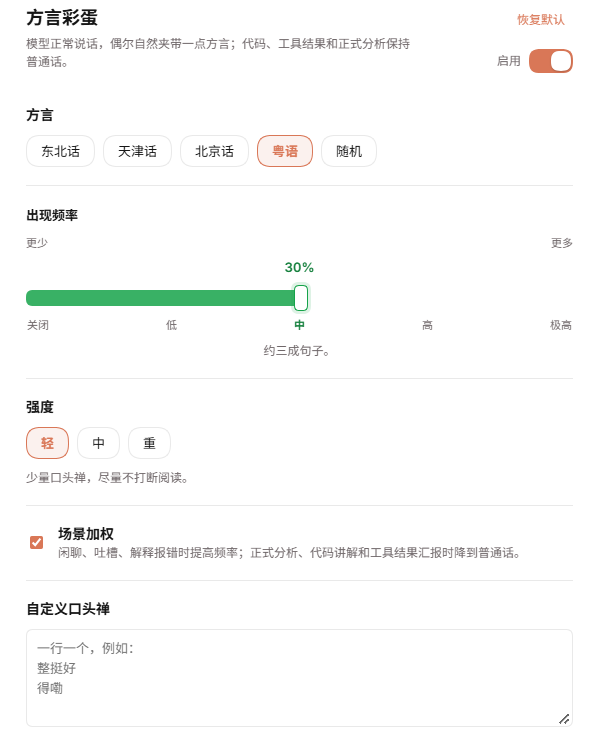
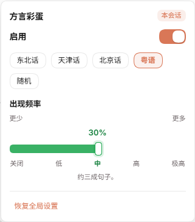
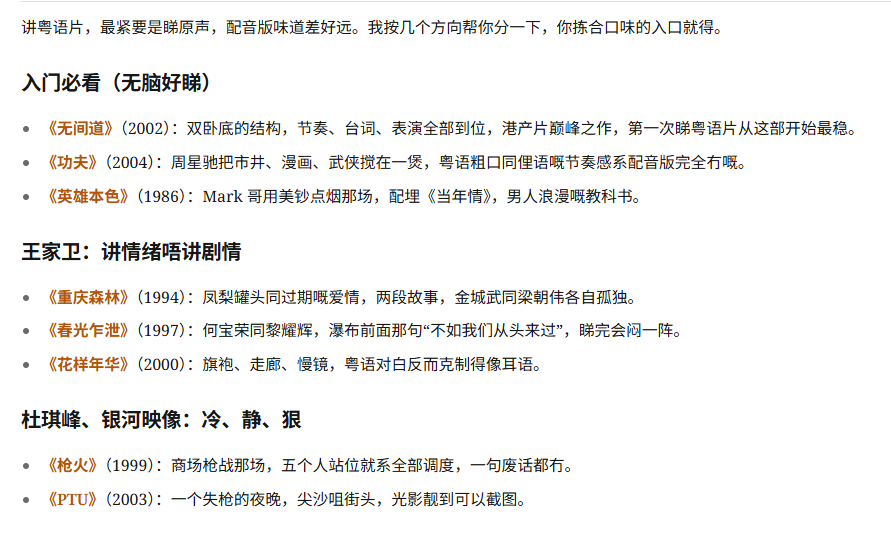

# dsh-dialect · 方言彩蛋

[English](README.en.md) | 中文

模型正常说普通话，偶尔自然夹带一点方言口头禅——东北话、天津话、北京话、粤语都行。设置页做完整配置，对话输入框旁按会话快捷切换；高和极高带颜色提示，不会把整段回答变成方言。

<p align="left">
  <a href="https://www.npmjs.com/package/dsh-dialect"></a>
  
  
  
  
</p>

## 截图

| 设置页 | 对话输入框 |
| --- | --- |
|  |  |

### 回答效果（粤语）



内容仅作语气示意。

## 功能

| 设置 | 说明 |
| --- | --- |
| 入口 | 设置 → 方言彩蛋管全局；对话输入框旁只改当前会话 |
| 方言 | 东北话、天津话、北京话、粤语、随机 |
| 随机池 | 选「随机」时，从勾选的方言里给每个会话抽一种，同一会话保持不变 |
| 频率 | 关闭 / 20% / 30% / 40% / 50% 五档，低灰、中绿、高橙、极高红 |
| 强度 | 轻、中、重，控制口头禅密度和句式改变程度 |
| 场景加权 | 闲聊、吐槽、解释报错时提高；正式分析、代码和工具结果时降到普通话 |
| 自定义口头禅 | 一行一条，最多 12 条、每条 24 字 |
| 自动保存 | 改动写进 `~/.dsh/dsh-dialect.json`，不用点保存 |

## 安装

```sh
# Web（推荐）
dsh plugin --profile web add dsh-dialect

# DSH Desktop
dsh plugin --profile desktop add dsh-dialect

# 或直接从 GitHub 装
dsh plugin --profile web add github:Luoqiaocong/dsh-dialect
```

也可以在 **Plugins → Add plugin** 里填 `dsh-dialect`，装完点 **Enable now**。刷新页面；设置里没有「方言彩蛋」就重启一次 `dsh web`。

## 使用

1. 打开 **设置 → 方言彩蛋**，选方言、随机池、频率和强度。
2. 想临时换个口音，点输入框左边的「语 东北话」按钮，只改当前会话。
3. 弹层里点「恢复全局设置」回到全局值；设置页右上角、开关旁边的「恢复默认」清空全局设置。

## 频率档位

| 档位 | 大致比例 | 说明 |
| --- | --- | --- |
| 关闭 | 0% | 完全不夹带 |
| 低 | 约 20% | 大约每五句一句，默认 |
| 中 | 约 30% | 大约每三句一句 |
| 高 | 约 40% | 四成句子带方言，最好闲聊使用 |
| 极高 | 约 50% | 一半句子带方言，最好闲聊使用 |

即使最高档也不是通篇方言；代码块、工具结果和文件内容始终是普通话。

## 兼容性

| 项目 | 说明 |
| --- | --- |
| DSH | `0.2.2-rc.1` 及以上（写在 `dsh.engines.dsh`，安装时校验） |
| Node | `24.9.0` 及以上 |
| 平台 | Web（Chrome / Edge / Firefox / Safari）与 DSH Desktop |
| 依赖 | 无运行时依赖；只访问本机 Host 路由，不联网、不采集数据 |
| 存储 | 全局设置写在 `~/.dsh/dsh-dialect.json`；会话覆盖只在内存 |

## 原理

- Host 注册一个系统提示词 section（`order: 100`），落在人格前缀和工具说明之间；
- 全局设置存本地 JSON，Host 的路由读写；浏览器 `localStorage` 只做首屏缓存；
- 对话页的临时覆盖按会话 id 存在 Host 内存里，不写全局文件；
- 随机模式按会话缓存抽签结果，不会每条消息换一种口音。

## 限制

- 提示词层面是软约束，频率是描述性目标，不是精确计数；
- 不改写代码块、工具输出、文件内容和已有会话记录；
- 子会话也会读到全局设置，需要完全普通话时给它单独关掉；
- 本地目录安装是 `link:`，目录别挪；从 npm 安装没有这个限制。

## 开发

无需构建，改 `lib/client.js` 或 `lib/index.js` 后刷新页面即可；`npm run check` 跑语法检查与两套零依赖冒烟测试。

## License

[MIT](LICENSE)
